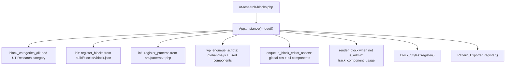

# UT Research Blocks

A WordPress plugin that adds University of Tennessee research blocks, page patterns, and block styles to the block editor. It's built and maintained by [Second Mile](https://www.thesecondmile.com/).

This document has two halves. The first half is a plain overview for anyone who wants to understand what the plugin does without reading code. The second half is the developer guide, with the build process, architecture, and the details you need to work on it.

## Contents

- [Overview](#overview)
  - [What this plugin does](#what-this-plugin-does)
  - [What you get](#what-you-get)
  - [Using it in the editor](#using-it-in-the-editor)
  - [What it needs to look right](#what-it-needs-to-look-right)
- [Developer guide](#developer-guide)
  - [How it fits together](#how-it-fits-together)
  - [Directory layout](#directory-layout)
  - [The PHP side](#the-php-side)
  - [Custom blocks](#custom-blocks)
  - [Patterns](#patterns)
  - [Block style variations](#block-style-variations)
  - [Build process](#build-process)
  - [Local setup and commands](#local-setup-and-commands)
  - [Distribution](#distribution)
  - [Deployment and CI](#deployment-and-ci)
  - [Things that trip people up](#things-that-trip-people-up)

---

# Overview

## What this plugin does

UT Research Blocks extends the WordPress block editor with UT-branded building tools for research sites. It doesn't replace your theme and it doesn't add settings screens for editors. It gives content authors extra blocks, ready-made section layouts, and styling options that all live inside the normal editing experience.

Think of it as three things bundled together: a handful of custom blocks, a library of prebuilt page sections, and a set of visual styles that get added onto standard WordPress blocks.

## What you get

**Custom blocks** (found under the "UT Research" category in the block inserter):

- **Lazy YouTube**: embeds a YouTube video that loads a lightweight thumbnail first and only pulls in the real player when someone clicks. It can play inline or open in a modal, and it has a lot of options for the thumbnail, the play button, and playback behavior.
- **Slider**: a carousel you fill with slides.
- **Slide**: one item inside a Slider. You can put anything in it (image, text, headings).
- **Slider Controls**: previous and next buttons that drive a specific Slider on the page.
- **Video Play/Pause Button**: a standalone button that plays or pauses a nearby standard Video block.

**Page patterns** (found under "UT Research" in the pattern inserter). These are complete, prebuilt sections you drop onto a page and then edit. There are 14 of them, covering page and video headers, a news grid, research spotlights and area grids, pullquotes over or beside a photo, carousels, decorative texture bars, framed image galleries, and a tabbed student experience section.

**Block styles**. These show up as style options on blocks you already use. Groups get wireframe-pattern backgrounds. Images and featured images get an orange carbon fiber frame. Several other styles (media left/right, skewed separators, news grid alignment) exist mainly to support the prebuilt patterns, so they look best when used inside those patterns rather than on a random block by itself.

## Using it in the editor

Everything is inserted the normal way. Open the block inserter, look under "UT Research" for the custom blocks, or open the patterns tab and pick a UT Research pattern to drop in a full section. Block styles appear in the block settings sidebar under Styles when you select a supported block.

The one thing worth knowing up front: the Slider Controls block connects to a Slider by a shared CSS class, not automatically. If you build a carousel by hand, you give the Slider a class (for example `slider-1`) and set the same class as the "bind to slider" value on the controls. The prebuilt "Carousel with Controls" pattern already wires this up, so starting from that pattern is the easy path.

## What it needs to look right

The plugin is designed to run alongside the [Torch WDS theme](https://github.com/utkwdn/utkwds), UT Knoxville's official Web Design System. Several patterns use Torch link and quote styles (`is-style-utkwds-cta-link`, `is-style-utkwds-single-link`, `utkwds-quote`, `utkwds-link-group`), and the Student Experience pattern uses Torch's `utk-wds/tab-group` and `utk-wds/tab` blocks. Color tokens like `--wp--custom--color--river` and `--wp--preset--color--smokey` also come from Torch's `theme.json`. Without that theme active, most things still work, but those pieces won't render fully.

Everything technical from here down is for developers.

---

# Developer guide

## How it fits together

The plugin entry file [ut-research-blocks.php](ut-research-blocks.php) defines a few constants and boots a singleton `App` class. There's no framework and no runtime Composer autoloading, just a manual `require_once` chain from the `App` class.

```php
require_once UT_RESEARCH_BLOCKS_DIR . 'src/Core/class-app.php';
\UTResearchBlocks\Core\App::instance()->boot();
```

A few design choices shape everything else:

- **All custom blocks are static.** They serialize their markup with a `Save` function (usually in `save.jsx`, sometimes co-located in `edit.jsx`), so there are no PHP render callbacks. What the editor saves is what ships to the front end.
- **Blocks and patterns are auto-discovered.** The plugin globs `build/blocks/*/block.json` to register blocks and `src/patterns/*.php` to register patterns. You don't hand-register anything, you just add files.
- **Only component CSS is usage-gated on the front end.** Stylesheets under `build/components/` load when their `utrb-*` class shows up in rendered markup. `build/global.css` and the two `build/block-styles/*.css` files always load. The editor loads every component stylesheet so the experience stays WYSIWYG.

Here's the boot sequence:



## Directory layout

```
ut-research-blocks/
  ut-research-blocks.php        Plugin bootstrap
  webpack.config.js             Extends @wordpress/scripts with extra entries
  build-dist.sh                 Builds and zips a distributable plugin
  .distignore                   What to strip from the distribution
  package.json                  npm scripts and dependencies
  composer.json                 Dev-only PHP tooling (PHPCS)
  src/
    Core/
      class-app.php             Bootstrap, registration, asset loading
      class-block-styles.php    Registers core block style variations
      class-pattern-exporter.php Admin tool under Tools > Export Pattern
    blocks/                     Source for the 5 custom blocks
    patterns/                   14 pattern files (PHP with header comments)
    assets/
      js/index.js               Global JS entry (imports main.scss)
      scss/
        main.scss               Global entry (variables + wp-blocks)
        components/             Pattern and sub-component stylesheets (16)
        block-styles/           Stylesheets for the two always-on block-style handles
        wp-blocks/              Core block overrides (query pagination)
        utilities/              Variables and mixins
        placeholders/           Shared SCSS placeholders
      images/                   Optimized WebP/SVG assets + placeholder PNG
                                _originals/ holds the carbon-fiber master
      videos/                   Placeholder MP4 used by Video Header
  build/                        Compiled output, gitignored, required at runtime
  dist/                         Distribution zip, gitignored
```

## The PHP side

All PHP lives in `src/Core/`. There are no custom post types, taxonomies, or REST endpoints.

### App ([src/Core/class-app.php](src/Core/class-app.php))

The main class. `boot()` wires up the hooks:

- `block_categories_all` adds the "UT Research" block category (slug `ut-research`).
- `init` registers blocks (globbing `build/blocks/*/block.json` and calling `register_block_type` on each directory) and patterns (globbing `src/patterns/*.php`, reading the header comment for metadata, and buffering the file output as the pattern content). Patterns register under the `ut-research-patterns` category, which also labels as "UT Research" in the inserter.
- `wp_enqueue_scripts` enqueues `build/global.css` and `build/global.js`, plus the component stylesheets that are actually used, plus inline CSS variables.
- `enqueue_block_editor_assets` enqueues `build/global.css` and the inline variables, and loads every component stylesheet so the editor matches the front end. It does not enqueue `global.js` (that file only exists to pull SCSS into the webpack build).
- `render_block` runs `track_component_usage`, but only when `! is_admin()`.

The conditional CSS logic is the interesting part. `track_component_usage` runs on every rendered block. It compares the rendered HTML against the list of available component stylesheets in `build/components/`. If it finds a matching `utrb-{name}` class, it flags that component as used. Later, `enqueue_component_styles` only enqueues the flagged ones. Blocks explicitly hidden via the Block Visibility metadata (`attrs.metadata.blockVisibility` set to false) are skipped, though note it only checks the block itself, not its parent. Video Header, for example, hides its video wrapper group with that flag.

`enqueue_inline_css` injects a `:root` block of CSS custom properties on both the front end and editor. These point at the plugin URL, 11 carbon-fiber WebP background images, and 5 wireframe SVG patterns under `src/assets/images/`. The master carbon-fiber source lives in `src/assets/images/_originals/` (excluded from distribution); see that folder's README for how the sized variants are produced. There is also a twelfth optimized WebP (`ut-research-orange-carbon-fiber-bg-3841x521.webp`) tracked in git but not registered as a CSS variable and not referenced in SCSS. Two of the wireframe URLs append a `?v=?2` query string in PHP (patterns 2 and 4-white).

Frontend asset enqueue checks that `build/global.*` files exist before proceeding. If you haven't run a build yet, the global assets simply don't load.

### Block_Styles ([src/Core/class-block-styles.php](src/Core/class-block-styles.php))

Registers block style variations against core blocks and enqueues the two block-style stylesheets (`geometric-background-patterns` and `orange-carbon-fiber-frame`) on every page via `init`. Those stylesheets are always on; they are not gated by whether a variation is used. See [Block style variations](#block-style-variations) for the full list and which styles actually have general-purpose CSS.

Unlike `App`'s frontend enqueue, this class does a bare `include` of `build/block-styles/*.asset.php` with no existence check. If `build/` is missing, that can fatal on `init`.

### Pattern_Exporter ([src/Core/class-pattern-exporter.php](src/Core/class-pattern-exporter.php))

Adds a Tools > Export Pattern admin page (requires `manage_options`). You paste block markup from the editor, and it generates the full PHP pattern file contents (header comment plus markup) for you to copy into `src/patterns/{slug}.php`. It doesn't write the file, it just gives you the text to save and commit.

## Custom blocks

The blocks live in `src/blocks/`, all use API version 3, the `ut-research` category, and the `ut-research-blocks` namespace. Each is static (a `Save` function, no PHP render callback), so its serialized markup is the source of truth. Four of the five blocks keep that in a separate `save.jsx`; Video Play/Pause defines `Save` inside `edit.jsx`. Attribute lists below cover the important ones. The full list is always in each block's `block.json`.

### Lazy YouTube ([src/blocks/lazy-youtube](src/blocks/lazy-youtube))

The most involved block by far (the editor component is about 980 lines). It renders a thumbnail plus a play button, and only loads the real YouTube player on interaction or when it scrolls into view.

Key behavior and attributes:

- `videoId` is the YouTube ID. The thumbnail can come from YouTube (`thumbnailType: youtube`, with a `youtubeThumbnailSize` like `maxresdefault`) or from the media library (`thumbnailType: custom`, using `customThumbnailId` and `customThumbnailSize`). In the editor it fetches media details through `@wordpress/api-fetch`.
- `playbackMode` is either `inline` (swaps the thumbnail for the player in place) or `modal` (opens the player in an overlay).
- `autoPlayOnViewport` uses an intersection observer to start playback when the block scrolls into view.
- `playerControls` (`youtube`, `none`, or `custom`) plus `playerRelated`, `playerFullscreen`, `playerLoop`, and `playerMute` map to YouTube IFrame player parameters.
- There are two play-button styling paths: the default button (`playButtonHorizontalAlignment`, `playButtonVerticalAlignment`, `playButtonWidthPercentage`) and a custom button (`customPlayButtonHorizontalPosition`, `customPlayButtonVerticalPosition`, `customPlayButtonWidth`, `customPlayButtonVisibility`).
- Caption support via `caption`, `captionPosition`, and `captionAlignment`, plus `imgAlt`, `loading` (`lazy` or `eager`), and `aspectRatio` (`landscape` or `portrait`).

The front-end script (`view.js`) loads the YouTube IFrame API on demand. Supports wide and full alignment.

### Slider ([src/blocks/slider](src/blocks/slider))

An [Embla Carousel](https://www.embla-carousel.com/) wrapper. It only allows `ut-research-blocks/slide` as inner blocks, and its default template inserts three slides.

Attributes control the carousel: `loop`, `align` (`start`, `center`, `end`), `slidesPerViewMobile/Tablet/Desktop` (default 1.2 / 2.3 / 3), and `containerGapMobile/Tablet/Desktop`. The per-view counts and gaps are written out as CSS custom properties on the wrapper.

On the front end, `view.js` finds every `.utrb-slider`, reads `data-loop` and `data-align`, initializes Embla, stores the instance on the element as `element.__emblaApi`, and fires an `emblaReady` custom event. That instance and event are how Slider Controls hooks in.

### Slide ([src/blocks/slide](src/blocks/slide))

A single carousel item. It has no attributes and no front-end script. Its width comes from the parent Slider's CSS variables. Inner blocks are freeform (default template is a single paragraph).

### Slider Controls ([src/blocks/slider-controls](src/blocks/slider-controls))

Previous and next buttons for a Slider. The single attribute `bindToSlider` holds the CSS class of the target slider (rendered as `data-bind-to-slider`).

On the front end, `view.js` reads that class, finds the matching slider element, and grabs its `__emblaApi`. If the slider isn't ready yet it waits for the `emblaReady` event. It wires clicks to `scrollPrev` / `scrollNext` and updates the disabled state of the buttons on Embla's `select` and `reInit` events, hiding both buttons when there's nothing to scroll.

Because the binding is by class, script load order doesn't matter (the controls fall back to the event if the slider hasn't initialized yet), but the classes have to match on both blocks.

### Video Play/Pause Button ([src/blocks/video-play-pause](src/blocks/video-play-pause))

A standalone button for a standard `core/video` block. The `targetVideoClass` attribute (rendered as `data-target-class`) is optional. Its `Save` function lives in `edit.jsx` rather than a separate `save.jsx`.

Its `view.js` finds the target video in this order: an explicit `.wp-block-video.{class}` if a class is set, otherwise the nearest video inside a `.wp-block-group`, `.wp-block-column`, `.wp-block-cover`, or `.wp-block-columns` ancestor, and finally any video in the closest `wp-block` ancestor. It toggles play/pause on click and keeps `aria-pressed` and `aria-label` in sync with the video's state.

## Patterns

Patterns are plain PHP files in `src/patterns/`. Each starts with a header comment that WordPress reads for metadata (Title, Slug, Description, Categories, Keywords, Viewport Width). The `App::register_patterns` method buffers the file's output as the pattern content, so a pattern file can use PHP (for example `plugins_url()` for placeholder images and video) and still register cleanly. Use `Categories: ut-research-patterns` in the header so the pattern lands in the right category.

Conventions to follow when adding one:

- The root wrapper uses a `utrb-{pattern-name}` class that maps to `build/components/{pattern-name}.css`. That mapping is what drives conditional CSS loading for pattern-level styles, so keep the class name and the SCSS filename in sync.
- Nested elements follow BEM (`__container`, `__content`, `__img-wrapper`, and so on).
- Inner groups often set `metadata.name` so the editor's list view is readable.
- Shared geometric background content often wraps in `utrb-geometric-bg__content`. That helper is styled by the always-on `geometric-background-patterns` stylesheet.

Not every file in `src/assets/scss/components/` is a pattern. Two are sub-components:

- `quote.scss` styles `.utrb-quote--white` (used by PullQuote with Photo Background).
- `research-area-card.scss` styles `.utrb-research-area-card` cards nested inside Research Areas Grid.

Those still get their own `build/components/{name}.css` files, and they load on the front end when their class appears in the markup (same tracking as the pattern stylesheets).

The 14 current patterns:

| Title | Slug |
| --- | --- |
| Advanced Columns | `ut-research-blocks/advanced-columns` |
| Background Textures | `ut-research-blocks/background-textures` |
| Carousel with Controls | `ut-research-blocks/carousel-with-controls` |
| Image Frames | `ut-research-blocks/image-frames` |
| New Page Header | `ut-research-blocks/new-page-header` |
| News Grid | `ut-research-blocks/news-grid` |
| Orange Texture Bar | `ut-research-blocks/orange-texture-bar` |
| PullQuote with Photo Background | `ut-research-blocks/pullquote-with-photo-bg` |
| PullQuote with Photo Side-by-Side Layout | `ut-research-blocks/pullquote-with-photo-side-by-side-layout` |
| Research Areas Grid | `ut-research-blocks/research-areas-grid` |
| Research Spotlight | `ut-research-blocks/research-spotlight` |
| Sliding Header | `ut-research-blocks/sliding-header` |
| Student Experience | `ut-research-blocks/student-experience` |
| Video Header | `ut-research-blocks/video-header` |

Sliding Header supports an optional class flag: add `utrb-sliding-header--animated` to the outer group's Additional CSS Classes to enable the image slide-in animation.

Orange Texture Bar's separator markup includes `is-style-utrb-orange-carbon-fiber`, but that style name is not registered in `Block_Styles`. The texture look comes from `.utrb-orange-texture-bar` SCSS targeting the separator inside the pattern, not from a registered block style.

## Block style variations

Registered in [src/Core/class-block-styles.php](src/Core/class-block-styles.php):

| Core block | Style name | Label | Where the CSS lives |
| --- | --- | --- | --- |
| `core/gallery` | `utrb-framed` | Framed | Registered only. No SCSS currently styles this. |
| `core/group` | `utrb-wireframe-pattern-1` | Wireframe Pattern 1 (On Gray) | Always-on `geometric-background-patterns.css` |
| `core/group` | `utrb-wireframe-pattern-2` | Wireframe Pattern 2 (On White) | Always-on `geometric-background-patterns.css` |
| `core/group` | `utrb-wireframe-pattern-3` | Wireframe Pattern 3 (On White) | Always-on `geometric-background-patterns.css` |
| `core/group` | `utrb-wireframe-pattern-4-gray` | Wireframe Pattern 4 (On Gray) | Always-on `geometric-background-patterns.css` |
| `core/group` | `utrb-wireframe-pattern-4-white` | Wireframe Pattern 4 (On White) | Always-on `geometric-background-patterns.css` |
| `core/group` | `utrb-show-media-on-left` | Show Media on Left | Pattern-scoped (advanced-columns, sliding-header, research-spotlight, student-experience) |
| `core/group` | `utrb-show-media-on-right` | Show Media on Right | Pattern-scoped (same set) |
| `core/separator` | `utrb-skewed-left` | Skewed Left | Pattern-scoped under `.utrb-orange-texture-bar` |
| `core/separator` | `utrb-skewed-right` | Skewed Right | Pattern-scoped under `.utrb-orange-texture-bar` |
| `core/image`, `core/post-featured-image` | `utrb-left-orange-carbon-fiber-frame` | Left Orange Carbon Fiber Frame | Always-on `orange-carbon-fiber-frame.css` |
| `core/image`, `core/post-featured-image` | `utrb-right-orange-carbon-fiber-frame` | Right Orange Carbon Fiber Frame | Always-on `orange-carbon-fiber-frame.css` |
| `core/post-template` | `utrb-news-grid-align-left` | News Grid: Align Left | Pattern-scoped under `.utrb-news-grid` |
| `core/post-template` | `utrb-news-grid-align-center` | News Grid: Align Center | Pattern-scoped under `.utrb-news-grid` |
| `core/post-template` | `utrb-news-grid-align-right` | News Grid: Align Right | Pattern-scoped under `.utrb-news-grid` |

The wireframe and carbon-fiber variations set a `style_handle`, but the matching stylesheets are still enqueued on every page in `Block_Styles::enqueue_block_styles()`. Pattern-scoped styles only look right when the parent pattern's component CSS is also loaded (which happens automatically when that pattern's `utrb-*` class is on the page).

## Build process

The build runs on [@wordpress/scripts](https://developer.wordpress.org/block-editor/reference-guides/packages/packages-scripts/), which wraps webpack. [webpack.config.js](webpack.config.js) extends the default config and adds four entry groups:

1. **Block bundles.** The default `@wordpress/scripts` entries compile each `src/blocks/*/index.js` (and `view.js` where present) into `build/blocks/{block}/`.
2. **`global`.** `src/assets/js/index.js` becomes `build/global.js`. That JS file only imports `main.scss` (which pulls in utilities and `wp-blocks/query-pagination`), so its real output is `build/global.css`.
3. **Per-component CSS.** Every file in `src/assets/scss/components/*.scss` is globbed into its own entry, producing `build/components/{name}.css` (16 files today: 14 pattern styles plus `quote` and `research-area-card`).
4. **Per block-style CSS.** Every file in `src/assets/scss/block-styles/*.scss` produces `build/block-styles/{name}.css`.

Each entry also emits a matching `.asset.php` file with version and dependency info, which the PHP enqueue code reads. Those `.asset.php` files are gitignored (`*.asset.php` in `.gitignore`), so they only exist after a local or CI build.

The resulting `build/` tree looks roughly like this:

```
build/
  global.js, global.css, global.asset.php
  blocks/
    lazy-youtube/  slider/  slide/  slider-controls/  video-play-pause/
  components/       16 CSS files (+ .asset.php each)
  block-styles/     2 CSS files (+ .asset.php each)
```

`build/` is gitignored. A fresh checkout won't register any blocks or load any styles until you run a build, so building is a required first step, not an optimization.

To scaffold a new block, `npm run create-block` runs `wp-create-block` inside `src/blocks/` with the plugin's namespace, text domain, and category preset. After adding a block, run a build so its `block.json` shows up under `build/blocks/` and gets auto-registered.

## Local setup and commands

Prerequisites: Node.js and npm, Composer, WordPress 6.4+, PHP 8.0+.

```bash
npm install
composer install
```

`npm install` also sets up the Husky pre-commit hook, which runs lint-staged (formats and lints staged JS/JSX, fixes staged CSS, and formats and lints staged PHP).

```bash
# Development build with watch
npm start

# Production build
npm run build
```

Linting and formatting:

```bash
npm run lint:all          # js, then css, then php
npm run lint:js           # ESLint (also :fix)
npm run lint:css          # Stylelint (also :fix)
npm run lint:php          # PHPCS via composer
npm run format:all        # wp-scripts format + composer format (phpcbf)
```

The linters are configured by `.eslintrc.js`, `.stylelintrc.json`, and `phpcs.xml`. Stylelint enforces a BEM-ish class pattern (`block`, `block__element`, `block--modifier`), which is why the `utrb-` naming is consistent across components.

## Distribution

```bash
./build-dist.sh
```

This runs `npm run build`, rsyncs the project into `dist/ut-research-blocks/` using `.distignore` to strip development files, and zips it to `dist/ut-research-blocks.zip`.

The important detail: the distribution ships the compiled `build/` folder but not the block or SCSS sources. `.distignore` excludes `src/blocks`, `src/assets/js`, `src/assets/scss`, `src/assets/images/_originals`, `webpack.config.js`, `package.json`, `README.md`, PHPCS/ESLint/lint-staged configs, and the rest of the dev tooling. It keeps `build/`, `src/Core/`, `src/patterns/`, the optimized images, and `src/assets/videos/` (the Video Header placeholder MP4). The production plugin runs entirely off the prebuilt assets.

## Deployment and CI

Two GitHub Actions workflows live in `.github/workflows/`:

- **[code-quality.yml](.github/workflows/code-quality.yml)** runs on pull requests. It installs npm and Composer dependencies and runs the JS, CSS, and PHP linters.
- **[deploy.yml](.github/workflows/deploy.yml)** is a template, left intentionally unconfigured. It's set to `workflow_dispatch` only, and the push-on-main trigger is commented out. It runs `npm ci` and `npm run build` (no Composer step), rsyncs through `.distignore` into a flat `dist/` folder (unlike `build-dist.sh`, which nests under `dist/ut-research-blocks/`), and deploys that folder to WP Engine via the `wpengine/github-action-wpe-site-deploy` action. That action expects the `WPE_SSHG_KEY_PRIVATE` secret and `WPE_ENV` variable. Wire it to your own environment (or replace the deploy step) before enabling it. Setup notes are in [.github/workflows/README.md](.github/workflows/README.md).

## Things that trip people up

- **You have to build first.** `build/` is gitignored (including `*.asset.php`), so blocks, styles, and patterns won't work on a fresh clone until `npm run build` (or `npm start`) has run. Missing `build/block-styles/*.asset.php` can fatal in `Block_Styles` because that class doesn't guard the `include`.
- **Slider and Slider Controls bind by class.** The controls target a slider by a shared CSS class (`bindToSlider`), not by block context or ID. Start from the Carousel with Controls pattern to get this right, or make sure the classes match by hand.
- **Torch WDS is a soft dependency.** Student Experience needs Torch's tab blocks. Pullquotes use `utkwds-quote`. Research Areas Grid uses `utkwds-link-group`. Several patterns use `is-style-utkwds-cta-link` or `is-style-utkwds-single-link`. SCSS also references Torch color tokens. Without Torch active, those pieces degrade.
- **Not all registered block styles are general-purpose.** Media left/right, skewed separators, and news-grid alignment only have CSS inside specific pattern stylesheets. The gallery "Framed" style is registered but currently has no CSS at all.
- **Conditional CSS only covers `build/components/`.** Global CSS and the two block-style stylesheets always load. A component stylesheet only loads on the front end if its `utrb-{name}` class is found in the rendered markup, and the component name has to match the SCSS filename. Rename one without the other and the styles silently stop loading.
- **The pattern exporter doesn't write files.** It generates the file contents in the admin UI. You still copy the output into `src/patterns/` and commit it yourself.
